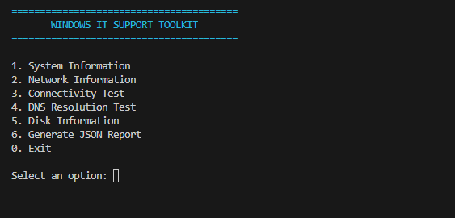
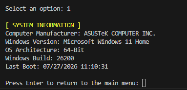
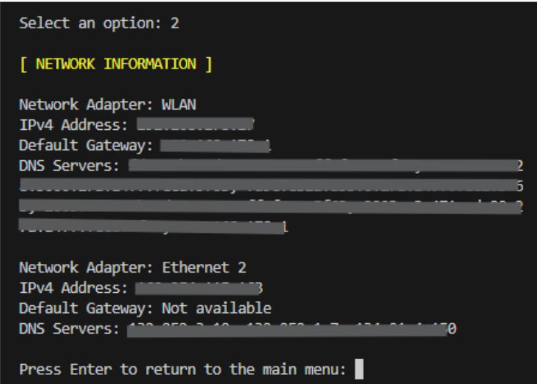
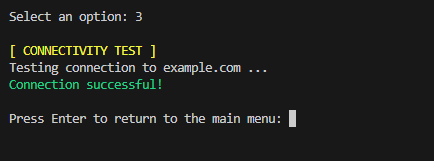
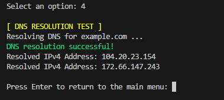
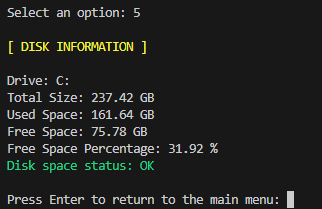
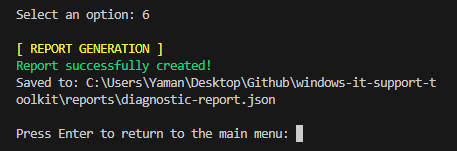

# Windows IT Support Toolkit

A PowerShell-based toolkit designed to demonstrate practical Windows IT support and troubleshooting skills.

## Features

- System information collection
- Network configuration overview
- Network connectivity testing
- DNS resolution testing
- Disk space monitoring
- Configurable diagnostic settings
- Automated JSON diagnostic reports
- Interactive PowerShell menu
- Error handling for common troubleshooting scenarios

## Technologies

- Windows PowerShell
- JSON
- Windows Management Instrumentation (WMI/CIM)
- Windows networking commands

## Project Structure

```text
windows-it-support-toolkit/
│
├── config/
│   └── settings.json
├── reports/
├── tests/
│   └── test-plan.md
├── evidence/
└── toolkit.ps1

## Screenshots

### Main Menu


### System Information


### Network Information


### Connectivity Test


### DNS Resolution Test


### Disk Information


### JSON Report Generation
